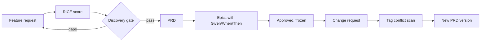

<h1 align="center">Product Management Skill Jev</h1>

<p align="center">
  <b>A product management co-pilot that writes the documents, keeps the process honest, and leaves every decision to you.</b><br>
  21 skills from feature request to change request · PRDs frozen on approval, changes become new versions · conflicts between PRDs found by a deterministic tag scan · plain markdown in a folder you own · Telegram, web portal or Claude Code · Anthropic, OpenAI, Gemini, Groq or a local Ollama model · 170 tests
</p>

<p align="center">
  <b>English</b> · <a href="_readmes/README.vi.md">Tiếng Việt</a> · <a href="_readmes/README.zh-CN.md">中文</a> · <a href="_readmes/README.ja.md">日本語</a> · <a href="_readmes/README.fr.md">Français</a> · <a href="_readmes/README.es.md">Español</a>
  <br>
  <a href="#quick-start">Quick start</a> ·
  <a href="#example">Example</a> ·
  <a href="#skills">Skills</a> ·
  <a href="AGENT.md">Agent rules</a> ·
  <a href="examples/aipm-skills-project">Sample project</a>
</p>

<p align="center">
  
  
  
  
  <a href="LICENSE"></a>
</p>

## Quick start

You need Docker and one model API key. Claude gives the best documents; a free Groq key is enough to try it.

```bash
git clone https://github.com/Nhat-Nguyet/product-skill-jev.git my-pm-workspace
cd my-pm-workspace
cp .env.example .env      # set AI_PROVIDER and one key, plus TELEGRAM_BOT_TOKEN for the bot
bash setup.sh             # 1) Telegram bot  2) web portal  3) both
```

What you get:

- **Web portal** at `http://localhost` (options 2 and 3): chat on the left, the document being written on the right, plus Projects, Settings and an Audit Log of every change. A sample project is copied into `my-projects/` so there is something to open on day one.
- **Telegram bot** (options 1 and 3): send `/start` to your bot, then `Show all projects`.
- **Claude Code** without Docker: `cp AGENT.md CLAUDE.md`, then run `claude` in the folder. The skills in `.claude/skills/` load by themselves.

All three work on the same files, so you can start an idea on your phone and finish the PRD at your desk.

## Example

You write ordinary sentences. The co-pilot asks only for the facts it is missing, shows a draft, and writes nothing until you confirm.

```
You   Create a feature request for a Telegram bot so PMs can capture ideas on the go
Jev   Two questions. Who is asking for this, and what problem does it solve?
You   PM team. Ideas die in voice memos and never become documents.
Jev   Draft of FR-001 below. Say "save" to write it.
You   save
Jev   Saved to discovery/inbox/FR-001-telegram-bot.md
      Next: "Score FR-001 with RICE"
```

From there the path is score, research, discovery gate, PRD, epics. Below is an excerpt of the epic at the end of that path in the [sample project](examples/aipm-skills-project), [`EP-001-v1.0.md`](examples/aipm-skills-project/epics/EP-001-telegram-bot/EP-001-v1.0.md):

```markdown
---
doc-id: EP-001
prd: PRD-001
version: v1.0
status: approved
module: Bot
sprint: S01
---

### US-001 - Send Feature Request

**As a** Product Manager,
**I want to** describe a feature in plain language to the bot,
**So that** a structured FR document is created automatically.

**Scenario 2 - Edge case: No active project set**
Given: PM has not opened a project in this session
When:  PM sends "Create a feature request"
Then:  Bot asks "Which project is this for?" before proceeding
```

Every document carries front matter that links it to the rest: FR to RICE score to PRD to epic, CR to the PRD version it produced.

## How it works



Three rules hold it together:

1. **It drafts, you decide.** Every skill ends by showing the draft and waiting for a yes.
2. **Approved means frozen.** A signed-off PRD is never edited. A change request produces v1.1 or v2.0, with the reason recorded in the changelog and in `VERSIONS.md`.
3. **The gate means something.** Features with RICE below 20 are steered towards a change request on an existing PRD. Research without a Security and Compliance section blocks the gate.

Each project is one folder of markdown:

```
my-projects/PROJ-002-checkout-redesign/
  PROJECT.md  VERSIONS.md
  discovery/  inbox/ scoring/ research/ gate/
  prd/        PRD-004-one-tap-checkout/PRD-004-v1.0.md, PRD-004-v1.1.md, CHANGELOG.md
  epics/  cr/  stakeholders/  decisions/  sprints/  reviews/
```

Open it in VS Code, Obsidian or any editor. Commit it to git and your PRD history becomes a readable diff.

## Why it is different

| | This project | A PRD prompt in a chat assistant | Hosted AI PRD tools |
|---|---|---|---|
| Where documents live | Plain markdown in your folder | A chat transcript you copy out | The vendor's workspace |
| Process | FR, RICE, gate, PRD, epic, CR, each skill suggests the next step | One document at a time | Mostly document drafting |
| After approval | Frozen, changes become new linked versions | Not tracked | Depends on the tool |
| Conflicts between PRDs | Python scan of shared module tags, then optional model ranking | Not covered | Depends on the tool |
| Model | Your choice of five providers, including a local model | The assistant's model | The vendor's model |
| Changing the behaviour | Edit a `SKILL.md` in plain English | Rewrite the prompt each time | Not possible |

The conflict scan ([`bot/tags.py`](bot/tags.py)) is ordinary code: it lists every pair of PRDs sharing a module tag and reports untagged PRDs as "not checkable", which is not the same as "no conflicts". A model is only asked afterwards whether a shared tag is a real collision.

The other rules (draft before write, frozen approvals, the gate) are instructions in the skills, carried out by the model. They are reliable with strong models and worth checking with weak ones.

## Skills

Each skill is a folder under [`.claude/skills/`](.claude/skills) with one `SKILL.md`. Claude Code picks them up from their descriptions; the bot and the web backend find them through the index in [`AGENT.md`](AGENT.md).

| Area | Skills |
|------|--------|
| Discovery | create-fr, score-feature, gate-review, deep-research |
| PRD | to-prd, manage-epic, conflict-check, grill-prd, update-prd |
| Project | create-project, find-project, project-status |
| Change requests | intake-cr, assess-cr, approve-cr |
| Stakeholders | add-stakeholder, draft-comms |
| Platform | setup-workspace, new-sprint, version-doc, product-skill-jev |

They are instructions, not code. Editing one changes how the co-pilot behaves.

The agent has seven tools and no others: `read_file`, `write_file`, `list_files`, `search_files`, `move_file`, `scan_tags` and `judge` (see [`bot/agent.py`](bot/agent.py)).

## Models

Set `AI_PROVIDER` in `.env`, or save several keys in the portal's Settings page and switch with a click. [`.env.example`](.env.example) has a ready block for each option.

| Provider | Setting |
|----------|---------|
| Anthropic Claude (best document quality) | `AI_PROVIDER=anthropic` |
| OpenAI | `AI_PROVIDER=openai` |
| Groq (free tier, good for trying it out) | `AI_PROVIDER=openai` with the Groq base URL |
| Google Gemini | `AI_PROVIDER=google` |
| Ollama (runs on your own machine) | `AI_PROVIDER=openai` with a localhost base URL |

## Optional: Jev classifier

Jev is a fast classifier from TypeSafe AI that returns labels with probabilities instead of prose. With `TYPESAFE_API_KEY` set, it suggests the type and urgency of stakeholder feedback, routes commands when the main provider is down, suggests a folder for uploaded files, and answers five typed question sets through the `judge` tool: `fr_triage`, `gate_review`, `rice_bands`, `cr_assessment`, `conflict_pair`.

Jev never writes a file. With no key, a timeout or low confidence, every path falls back to the behaviour without Jev. Questions and thresholds live in [`bot/jev.py`](bot/jev.py); the portal can override thresholds and restore the defaults. Details: [`.claude/skills/product-skill-jev`](.claude/skills/product-skill-jev/SKILL.md).

## Commands and tests

```bash
make start | stop | restart | logs | status | update     # Telegram bot, from the repository root
cd apps && make start | stop | logs | build               # web portal
```

```bash
pip install -r tests/requirements.txt -r apps/backend/requirements.txt -r bot/requirements.txt
cd apps/backend && python3 -m pytest ../../tests/
```

The suite has 170 tests in five files (installation 35, agent tools 26, backend API 26, Jev 61, tag scan 22). With a `.env` file in place (the Docker config checks read it) and no backend running, 144 pass and the 26 API tests skip themselves. No test calls a paid API.

## What it is not

It does not talk to your customers and it does not tell you what to build. It writes well and forgets nothing, which is a different skill from judgment. The judgment stays yours.

## Credits and license

Built on ideas from [mattpocock/skills](https://github.com/mattpocock/skills) (skill format), [RICE scoring](https://www.intercom.com/blog/rice-simple-prioritization-for-product-managers/) (Intercom), [Continuous Discovery Habits](https://www.producttalk.org/) (Teresa Torres), [Inspired](https://www.svpg.com/books/inspired-how-to-create-tech-products-customers-love-2nd-edition/) (Marty Cagan), [user stories](https://www.mountaingoatsoftware.com/agile/user-stories) (Mike Cohn) and [Architectural Decision Records](https://adr.github.io/).

Maintained by [Nhat Nguyet](https://github.com/Nhat-Nguyet). Licensed under [CC BY-NC 4.0](LICENSE): free to use, share and adapt for non-commercial purposes with attribution.
