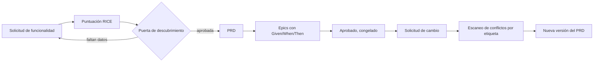

<h1 align="center">Product Management Skill Jev</h1>

<p align="center">
  <b>Un copiloto de gestión de producto que redacta los documentos, mantiene el proceso honesto y te deja todas las decisiones.</b><br>
  21 habilidades, de la solicitud de funcionalidad a la solicitud de cambio · los PRD se congelan al aprobarse y cada cambio crea una versión nueva · los conflictos entre PRD se detectan con un escaneo de etiquetas determinista · markdown simple en una carpeta tuya · Telegram, portal web o Claude Code · Anthropic, OpenAI, Gemini, Groq o un modelo local con Ollama · 170 tests
</p>

<p align="center">
  <a href="../README.md">English</a> · <a href="README.vi.md">Tiếng Việt</a> · <a href="README.zh-CN.md">中文</a> · <a href="README.ja.md">日本語</a> · <a href="README.fr.md">Français</a> · <b>Español</b>
  <br>
  <a href="#inicio-rápido">Inicio rápido</a> ·
  <a href="#ejemplo">Ejemplo</a> ·
  <a href="#habilidades">Habilidades</a> ·
  <a href="../AGENT.md">Reglas del agente</a> ·
  <a href="../examples/aipm-skills-project">Proyecto de ejemplo</a>
</p>

<p align="center">
  
  
  
  
  <a href="../LICENSE"></a>
</p>

> La versión en inglés ([README.md](../README.md)) es la original. Esta traducción recoge los mismos datos y la misma estructura.

## Inicio rápido

Necesitas Docker y una clave de API de un modelo. Claude da los mejores documentos; una clave gratuita de Groq basta para probarlo.

```bash
git clone https://github.com/Nhat-Nguyet/product-skill-jev.git my-pm-workspace
cd my-pm-workspace
cp .env.example .env      # define AI_PROVIDER y una clave, más TELEGRAM_BOT_TOKEN para el bot
bash setup.sh             # 1) bot de Telegram  2) portal web  3) ambos
```

Lo que obtienes:

- **Portal web** en `http://localhost` (opciones 2 y 3): el chat a la izquierda, el documento que se está escribiendo a la derecha, más las páginas Proyectos, Ajustes y un registro de auditoría de cada cambio. Se copia un proyecto de ejemplo en `my-projects/` para tener algo que abrir desde el primer día.
- **Bot de Telegram** (opciones 1 y 3): envía `/start` a tu bot y luego `Show all projects`.
- **Claude Code**, sin Docker: `cp AGENT.md CLAUDE.md` y ejecuta `claude` en la carpeta. Las habilidades de `.claude/skills/` se cargan solas.

Los tres trabajan sobre los mismos archivos: puedes apuntar una idea en el móvil y terminar el PRD en tu escritorio.

## Ejemplo

Escribes frases normales. El copiloto solo pregunta los datos que faltan, muestra un borrador y no escribe nada hasta que confirmas.

```
Tú    Crea una solicitud de funcionalidad: un bot de Telegram para que los PM apunten ideas fuera de la oficina
Jev   Dos preguntas. ¿Quién lo pide y qué problema resuelve?
Tú    El equipo de PM. Las ideas mueren en notas de voz y nunca se convierten en documentos.
Jev   Aquí está el borrador de FR-001. Di "guarda" para escribirlo.
Tú    guarda
Jev   Guardado en discovery/inbox/FR-001-telegram-bot.md
      Siguiente: "Puntúa FR-001 con RICE"
```

A partir de ahí el camino es puntuación, investigación, puerta de descubrimiento, PRD y epics. Este es un extracto de la epic al final de ese camino en el [proyecto de ejemplo](../examples/aipm-skills-project), [`EP-001-v1.0.md`](../examples/aipm-skills-project/epics/EP-001-telegram-bot/EP-001-v1.0.md):

```markdown
---
doc-id: EP-001
prd: PRD-001
version: v1.0
status: approved
module: Bot
sprint: S01
---

### US-001 - Send Feature Request

**As a** Product Manager,
**I want to** describe a feature in plain language to the bot,
**So that** a structured FR document is created automatically.

**Scenario 2 - Edge case: No active project set**
Given: PM has not opened a project in this session
When:  PM sends "Create a feature request"
Then:  Bot asks "Which project is this for?" before proceeding
```

Cada documento lleva un encabezado (front matter) que lo enlaza con el resto: FR con su puntuación RICE, el PRD y la epic; CR con la versión de PRD que produjo.

## Cómo funciona



Tres reglas sostienen todo:

1. **Él redacta, tú decides.** Cada habilidad termina mostrando el borrador y esperando tu sí.
2. **Aprobado significa congelado.** Un PRD aprobado no se edita. Una solicitud de cambio produce una v1.1 o una v2.0, con el motivo anotado en el changelog y en `VERSIONS.md`.
3. **La puerta significa algo.** Las funcionalidades con RICE inferior a 20 se reorientan hacia una solicitud de cambio sobre un PRD existente. Una investigación sin sección de Seguridad y cumplimiento bloquea la puerta.

Cada proyecto es una carpeta de markdown:

```
my-projects/PROJ-002-checkout-redesign/
  PROJECT.md  VERSIONS.md
  discovery/  inbox/ scoring/ research/ gate/
  prd/        PRD-004-one-tap-checkout/PRD-004-v1.0.md, PRD-004-v1.1.md, CHANGELOG.md
  epics/  cr/  stakeholders/  decisions/  sprints/  reviews/
```

Ábrela en VS Code, Obsidian o cualquier editor. Súbela a git y el historial de tus PRD se convierte en un diff legible.

## Qué lo hace distinto

| | Este proyecto | Un prompt de PRD en un asistente de chat | Herramientas alojadas de PRD con IA |
|---|---|---|---|
| Dónde viven los documentos | Markdown simple en tu carpeta | Una conversación que hay que copiar | El espacio de trabajo del proveedor |
| Proceso | FR, RICE, puerta, PRD, epic, CR; cada habilidad sugiere el paso siguiente | Un documento cada vez | Sobre todo redacción |
| Tras la aprobación | Congelado, los cambios son versiones nuevas enlazadas | Sin seguimiento | Depende de la herramienta |
| Conflictos entre PRD | Escaneo en Python de etiquetas de módulo compartidas, luego clasificación opcional por el modelo | No cubierto | Depende de la herramienta |
| Modelo | A elegir entre cinco proveedores, incluido un modelo local | El del asistente | El del proveedor |
| Cambiar el comportamiento | Editar un `SKILL.md` en lenguaje normal | Reescribir el prompt cada vez | No es posible |

El escaneo de conflictos ([`bot/tags.py`](../bot/tags.py)) es código normal: lista cada par de PRD que comparte una etiqueta de módulo y marca los PRD sin etiquetas como "no comprobables", que no es lo mismo que "sin conflictos". Solo después se pregunta al modelo si una etiqueta compartida es una colisión real.

Las demás reglas (borrador antes de escribir, documentos aprobados congelados, la puerta) son instrucciones en las habilidades que ejecuta el modelo. Son fiables con modelos potentes y conviene revisarlas con modelos débiles.

## Habilidades

Cada habilidad es una carpeta en [`.claude/skills/`](../.claude/skills) con un `SKILL.md`. Claude Code las encuentra por su descripción; el bot y el backend web, por el índice de [`AGENT.md`](../AGENT.md).

| Área | Habilidades |
|------|--------|
| Descubrimiento | create-fr, score-feature, gate-review, deep-research |
| PRD | to-prd, manage-epic, conflict-check, grill-prd, update-prd |
| Proyecto | create-project, find-project, project-status |
| Solicitudes de cambio | intake-cr, assess-cr, approve-cr |
| Partes interesadas | add-stakeholder, draft-comms |
| Plataforma | setup-workspace, new-sprint, version-doc, product-skill-jev |

Son instrucciones, no código. Editar una cambia cómo se comporta el copiloto.

El agente tiene siete herramientas y ninguna más: `read_file`, `write_file`, `list_files`, `search_files`, `move_file`, `scan_tags` y `judge` (ver [`bot/agent.py`](../bot/agent.py)).

## Modelos

Define `AI_PROVIDER` en `.env`, o guarda varias claves en la página Ajustes del portal y cambia con un clic. [`.env.example`](../.env.example) trae un bloque listo para cada opción.

| Proveedor | Ajuste |
|----------|---------|
| Anthropic Claude (mejor calidad de documentos) | `AI_PROVIDER=anthropic` |
| OpenAI | `AI_PROVIDER=openai` |
| Groq (plan gratuito, bueno para probar) | `AI_PROVIDER=openai` con la URL base de Groq |
| Google Gemini | `AI_PROVIDER=google` |
| Ollama (se ejecuta en tu propia máquina) | `AI_PROVIDER=openai` con una URL base localhost |

## Opcional: el clasificador Jev

Jev es un clasificador rápido de TypeSafe AI que devuelve etiquetas con probabilidades en lugar de texto. Con `TYPESAFE_API_KEY` definida, sugiere el tipo y la urgencia de los comentarios de las partes interesadas, enruta comandos cuando el proveedor principal falla, propone una carpeta para los archivos subidos y responde a cinco conjuntos de preguntas tipadas mediante la herramienta `judge`: `fr_triage`, `gate_review`, `rice_bands`, `cr_assessment`, `conflict_pair`.

Jev nunca escribe archivos. Sin clave, con tiempo de espera agotado o con baja confianza, cada camino vuelve al comportamiento sin Jev. Las preguntas y los umbrales están en [`bot/jev.py`](../bot/jev.py); el portal permite sobrescribir umbrales y restaurar los valores por defecto. Detalles: [`.claude/skills/product-skill-jev`](../.claude/skills/product-skill-jev/SKILL.md).

## Comandos y tests

```bash
make start | stop | restart | logs | status | update     # bot de Telegram, desde la raíz del repositorio
cd apps && make start | stop | logs | build               # portal web
```

```bash
pip install -r tests/requirements.txt -r apps/backend/requirements.txt -r bot/requirements.txt
cd apps/backend && python3 -m pytest ../../tests/
```

La suite tiene 170 tests en cinco archivos (instalación 35, herramientas del agente 26, API del backend 26, Jev 61, escaneo de etiquetas 22). Con un archivo `.env` presente (las comprobaciones de configuración de Docker lo leen) y sin backend en marcha, pasan 144 y los 26 tests de API se omiten solos. Ningún test llama a una API de pago.

## Lo que no es

No habla con tus clientes ni te dice qué construir. Escribe bien y no olvida nada, que es una habilidad distinta del criterio. El criterio sigue siendo tuyo.

## Créditos y licencia

Basado en ideas de [mattpocock/skills](https://github.com/mattpocock/skills) (formato de habilidades), la [puntuación RICE](https://www.intercom.com/blog/rice-simple-prioritization-for-product-managers/) (Intercom), [Continuous Discovery Habits](https://www.producttalk.org/) (Teresa Torres), [Inspired](https://www.svpg.com/books/inspired-how-to-create-tech-products-customers-love-2nd-edition/) (Marty Cagan), las [historias de usuario](https://www.mountaingoatsoftware.com/agile/user-stories) (Mike Cohn) y los [Architectural Decision Records](https://adr.github.io/).

Mantenido por [Nhat Nguyet](https://github.com/Nhat-Nguyet). Licencia [CC BY-NC 4.0](../LICENSE): puedes usarlo, compartirlo y adaptarlo con fines no comerciales, citando la autoría.
