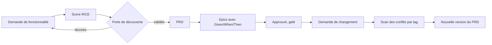

<h1 align="center">Product Management Skill Jev</h1>

<p align="center">
  <b>Un copilote de gestion de produit qui rédige les documents, garde le processus honnête et vous laisse toutes les décisions.</b><br>
  21 compétences, de la demande de fonctionnalité à la demande de changement · PRD gelés une fois approuvés, chaque changement crée une nouvelle version · conflits entre PRD détectés par un scan de tags déterministe · du markdown simple dans un dossier qui vous appartient · Telegram, portail web ou Claude Code · Anthropic, OpenAI, Gemini, Groq ou un modèle Ollama local · 170 tests
</p>

<p align="center">
  <a href="../README.md">English</a> · <a href="README.vi.md">Tiếng Việt</a> · <a href="README.zh-CN.md">中文</a> · <a href="README.ja.md">日本語</a> · <b>Français</b> · <a href="README.es.md">Español</a>
  <br>
  <a href="#démarrage-rapide">Démarrage rapide</a> ·
  <a href="#exemple">Exemple</a> ·
  <a href="#compétences">Compétences</a> ·
  <a href="../AGENT.md">Règles de l'agent</a> ·
  <a href="../examples/aipm-skills-project">Projet d'exemple</a>
</p>

<p align="center">
  
  
  
  
  <a href="../LICENSE"></a>
</p>

> La version anglaise ([README.md](../README.md)) fait foi. Cette traduction en reprend les faits et la structure.

## Démarrage rapide

Il faut Docker et une clé d'API de modèle. Claude produit les meilleurs documents ; une clé Groq gratuite suffit pour essayer.

```bash
git clone https://github.com/Nhat-Nguyet/product-skill-jev.git my-pm-workspace
cd my-pm-workspace
cp .env.example .env      # renseigner AI_PROVIDER et une clé, plus TELEGRAM_BOT_TOKEN pour le bot
bash setup.sh             # 1) bot Telegram  2) portail web  3) les deux
```

Ce que vous obtenez :

- **Portail web** sur `http://localhost` (options 2 et 3) : la conversation à gauche, le document en cours de rédaction à droite, plus les pages Projets, Paramètres et un journal d'audit de chaque modification. Un projet d'exemple est copié dans `my-projects/` pour avoir quelque chose à ouvrir dès le premier jour.
- **Bot Telegram** (options 1 et 3) : envoyez `/start` à votre bot, puis `Show all projects`.
- **Claude Code**, sans Docker : `cp AGENT.md CLAUDE.md`, puis lancez `claude` dans le dossier. Les compétences de `.claude/skills/` se chargent seules.

Les trois travaillent sur les mêmes fichiers : vous notez une idée sur votre téléphone et terminez le PRD à votre bureau.

## Exemple

Vous écrivez des phrases ordinaires. Le copilote ne demande que les faits manquants, montre un brouillon et n'écrit rien avant votre confirmation.

```
Vous  Crée une demande de fonctionnalité : un bot Telegram pour que les PM notent leurs idées en déplacement
Jev   Deux questions. Qui le demande, et quel problème cela résout-il ?
Vous  L'équipe PM. Les idées meurent dans des mémos vocaux et ne deviennent jamais des documents.
Jev   Voici le brouillon de FR-001. Dites « enregistre » pour l'écrire.
Vous  enregistre
Jev   Enregistré dans discovery/inbox/FR-001-telegram-bot.md
      Suite : « Score FR-001 avec RICE »
```

Ensuite vient le score, la recherche, la porte de découverte, le PRD, les epics. Voici un extrait de l'epic qui termine ce parcours dans le [projet d'exemple](../examples/aipm-skills-project), [`EP-001-v1.0.md`](../examples/aipm-skills-project/epics/EP-001-telegram-bot/EP-001-v1.0.md) :

```markdown
---
doc-id: EP-001
prd: PRD-001
version: v1.0
status: approved
module: Bot
sprint: S01
---

### US-001 - Send Feature Request

**As a** Product Manager,
**I want to** describe a feature in plain language to the bot,
**So that** a structured FR document is created automatically.

**Scenario 2 - Edge case: No active project set**
Given: PM has not opened a project in this session
When:  PM sends "Create a feature request"
Then:  Bot asks "Which project is this for?" before proceeding
```

Chaque document porte un en-tête (front matter) qui le relie aux autres : FR vers score RICE, PRD et epic, CR vers la version de PRD qu'il a produite.

## Fonctionnement



Trois règles tiennent l'ensemble :

1. **Il rédige, vous décidez.** Chaque compétence se termine en montrant le brouillon et en attendant votre accord.
2. **Approuvé veut dire gelé.** Un PRD validé n'est plus modifié. Une demande de changement produit une v1.1 ou une v2.0, avec la raison inscrite dans le changelog et dans `VERSIONS.md`.
3. **La porte a du sens.** Une fonctionnalité dont le score RICE est inférieur à 20 est orientée vers une demande de changement sur un PRD existant. Une recherche sans section Sécurité et conformité bloque la porte.

Chaque projet est un dossier de markdown :

```
my-projects/PROJ-002-checkout-redesign/
  PROJECT.md  VERSIONS.md
  discovery/  inbox/ scoring/ research/ gate/
  prd/        PRD-004-one-tap-checkout/PRD-004-v1.0.md, PRD-004-v1.1.md, CHANGELOG.md
  epics/  cr/  stakeholders/  decisions/  sprints/  reviews/
```

Ouvrez-le dans VS Code, Obsidian ou n'importe quel éditeur. Versionnez-le dans git et l'historique de vos PRD devient un diff lisible.

## Ce qui le distingue

| | Ce projet | Un prompt de PRD dans un assistant conversationnel | Outils hébergés de rédaction de PRD par IA |
|---|---|---|---|
| Où vivent les documents | Markdown simple dans votre dossier | Une conversation à recopier | L'espace de travail du fournisseur |
| Processus | FR, RICE, porte, PRD, epic, CR ; chaque compétence propose l'étape suivante | Un document à la fois | Surtout de la rédaction |
| Après approbation | Gelé, les changements deviennent de nouvelles versions liées | Non suivi | Selon l'outil |
| Conflits entre PRD | Scan Python des tags de module partagés, puis classement facultatif par le modèle | Non couvert | Selon l'outil |
| Modèle | Au choix parmi cinq fournisseurs, dont un modèle local | Celui de l'assistant | Celui du fournisseur |
| Modifier le comportement | Éditer un `SKILL.md` en langage courant | Réécrire le prompt à chaque fois | Impossible |

Le scan de conflits ([`bot/tags.py`](../bot/tags.py)) est du code ordinaire : il liste chaque paire de PRD partageant un tag de module et signale les PRD sans tag comme « non vérifiables », ce qui n'est pas la même chose que « sans conflit ». Ce n'est qu'ensuite qu'on demande au modèle si un tag partagé est une vraie collision.

Les autres règles (brouillon avant écriture, documents approuvés gelés, porte) sont des instructions dans les compétences, appliquées par le modèle. Elles sont fiables avec un modèle puissant et méritent d'être vérifiées avec un modèle plus faible.

## Compétences

Chaque compétence est un dossier sous [`.claude/skills/`](../.claude/skills) contenant un `SKILL.md`. Claude Code les trouve par leur description ; le bot et le backend web les trouvent via l'index de [`AGENT.md`](../AGENT.md).

| Domaine | Compétences |
|------|--------|
| Découverte | create-fr, score-feature, gate-review, deep-research |
| PRD | to-prd, manage-epic, conflict-check, grill-prd, update-prd |
| Projet | create-project, find-project, project-status |
| Demandes de changement | intake-cr, assess-cr, approve-cr |
| Parties prenantes | add-stakeholder, draft-comms |
| Plateforme | setup-workspace, new-sprint, version-doc, product-skill-jev |

Ce sont des instructions, pas du code. En modifier une change le comportement du copilote.

L'agent dispose de sept outils et d'aucun autre : `read_file`, `write_file`, `list_files`, `search_files`, `move_file`, `scan_tags` et `judge` (voir [`bot/agent.py`](../bot/agent.py)).

## Modèles

Définissez `AI_PROVIDER` dans `.env`, ou enregistrez plusieurs clés dans la page Paramètres du portail et passez de l'une à l'autre d'un clic. [`.env.example`](../.env.example) contient un bloc prêt pour chaque option.

| Fournisseur | Réglage |
|----------|---------|
| Anthropic Claude (meilleure qualité de documents) | `AI_PROVIDER=anthropic` |
| OpenAI | `AI_PROVIDER=openai` |
| Groq (offre gratuite, bien pour essayer) | `AI_PROVIDER=openai` avec l'URL de base de Groq |
| Google Gemini | `AI_PROVIDER=google` |
| Ollama (tourne sur votre machine) | `AI_PROVIDER=openai` avec une URL de base localhost |

## Facultatif : le classifieur Jev

Jev est un classifieur rapide de TypeSafe AI qui renvoie des étiquettes avec des probabilités plutôt que du texte. Avec `TYPESAFE_API_KEY` renseignée, il suggère le type et l'urgence des retours des parties prenantes, aiguille les commandes quand le fournisseur principal est indisponible, propose un dossier pour les fichiers envoyés et répond à cinq jeux de questions typées via l'outil `judge` : `fr_triage`, `gate_review`, `rice_bands`, `cr_assessment`, `conflict_pair`.

Jev n'écrit jamais de fichier. Sans clé, en cas de délai dépassé ou de faible confiance, chaque chemin revient au comportement sans Jev. Les questions et les seuils sont dans [`bot/jev.py`](../bot/jev.py) ; le portail peut surcharger les seuils et restaurer les valeurs par défaut. Détails : [`.claude/skills/product-skill-jev`](../.claude/skills/product-skill-jev/SKILL.md).

## Commandes et tests

```bash
make start | stop | restart | logs | status | update     # bot Telegram, depuis la racine du dépôt
cd apps && make start | stop | logs | build               # portail web
```

```bash
pip install -r tests/requirements.txt -r apps/backend/requirements.txt -r bot/requirements.txt
cd apps/backend && python3 -m pytest ../../tests/
```

La suite compte 170 tests répartis dans cinq fichiers (installation 35, outils de l'agent 26, API du backend 26, Jev 61, scan de tags 22). Avec un fichier `.env` en place (les vérifications de configuration Docker le lisent) et sans backend démarré, 144 passent et les 26 tests d'API sont ignorés automatiquement. Aucun test n'appelle d'API payante.

## Ce qu'il n'est pas

Il ne parle pas à vos clients et ne vous dit pas quoi construire. Il écrit bien et n'oublie rien, ce qui est une compétence différente du jugement. Le jugement reste le vôtre.

## Remerciements et licence

Inspiré par [mattpocock/skills](https://github.com/mattpocock/skills) (format des compétences), le [score RICE](https://www.intercom.com/blog/rice-simple-prioritization-for-product-managers/) (Intercom), [Continuous Discovery Habits](https://www.producttalk.org/) (Teresa Torres), [Inspired](https://www.svpg.com/books/inspired-how-to-create-tech-products-customers-love-2nd-edition/) (Marty Cagan), les [user stories](https://www.mountaingoatsoftware.com/agile/user-stories) (Mike Cohn) et les [Architectural Decision Records](https://adr.github.io/).

Maintenu par [Nhat Nguyet](https://github.com/Nhat-Nguyet). Sous licence [CC BY-NC 4.0](../LICENSE) : libre d'utiliser, partager et adapter à des fins non commerciales, avec attribution.
