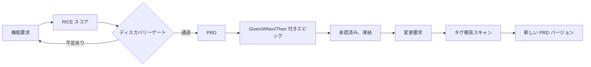

<h1 align="center">Product Management Skill Jev</h1>

<p align="center">
  <b>ドキュメントを書き、プロセスを誠実に保ち、すべての判断をあなたに委ねるプロダクトマネジメントのコパイロット。</b><br>
  機能要求から変更要求までの 21 スキル · 承認済み PRD は凍結、変更は新しいバージョンに · PRD 間の衝突は決定的なタグスキャンで検出 · あなたのフォルダに置かれるプレーンな Markdown · Telegram、Web ポータル、Claude Code · Anthropic、OpenAI、Gemini、Groq、ローカルの Ollama モデル · テスト 170 件
</p>

<p align="center">
  <a href="../README.md">English</a> · <a href="README.vi.md">Tiếng Việt</a> · <a href="README.zh-CN.md">中文</a> · <b>日本語</b> · <a href="README.fr.md">Français</a> · <a href="README.es.md">Español</a>
  <br>
  <a href="#クイックスタート">クイックスタート</a> ·
  <a href="#例">例</a> ·
  <a href="#スキル">スキル</a> ·
  <a href="../AGENT.md">エージェントのルール</a> ·
  <a href="../examples/aipm-skills-project">サンプルプロジェクト</a>
</p>

<p align="center">
  
  
  
  
  <a href="../LICENSE"></a>
</p>

> 英語版 [README.md](../README.md) が原文です。この翻訳は同じ事実と同じ構成を保っています。

## クイックスタート

Docker とモデルの API キーが 1 つ必要です。ドキュメントの品質は Claude が最も高く、試すだけなら無料の Groq キーで十分です。

```bash
git clone https://github.com/Nhat-Nguyet/product-skill-jev.git my-pm-workspace
cd my-pm-workspace
cp .env.example .env      # AI_PROVIDER とキーを 1 つ設定。ボットを使うなら TELEGRAM_BOT_TOKEN も
bash setup.sh             # 1) Telegram ボット  2) Web ポータル  3) 両方
```

得られるもの:

- **Web ポータル** `http://localhost`(選択肢 2 と 3): 左にチャット、右に書きかけのドキュメント。ほかにプロジェクト、設定、すべての変更を記録する監査ログ。サンプルプロジェクトが `my-projects/` にコピーされるので、初日から開いて見られます。
- **Telegram ボット**(選択肢 1 と 3): ボットに `/start`、続けて `Show all projects` を送ります。
- **Claude Code**(Docker 不要): `cp AGENT.md CLAUDE.md` のあと、フォルダ内で `claude` を実行します。`.claude/skills/` のスキルは自動で読み込まれます。

3 つとも同じファイルを扱うので、スマートフォンで思いついたアイデアを机で PRD に仕上げられます。

## 例

普通の文で話しかけます。コパイロットは足りない事実だけを尋ね、下書きを見せ、あなたが確認するまで何も書き込みません。

```
あなた  外出先でも PM がアイデアを記録できる Telegram ボットの機能要求を作って
Jev     2 つ質問です。誰の要望で、どんな問題を解決しますか?
あなた  PM チーム。アイデアがボイスメモに埋もれて、ドキュメントにならない。
Jev     FR-001 の下書きです。「保存」と言えば書き込みます。
あなた  保存
Jev     discovery/inbox/FR-001-telegram-bot.md に保存しました
        次: 「FR-001 を RICE で採点」
```

その先はスコアリング、リサーチ、ディスカバリーゲート、PRD、エピックと進みます。以下は[サンプルプロジェクト](../examples/aipm-skills-project)でその道の終点にあるエピック [`EP-001-v1.0.md`](../examples/aipm-skills-project/epics/EP-001-telegram-bot/EP-001-v1.0.md) の抜粋です:

```markdown
---
doc-id: EP-001
prd: PRD-001
version: v1.0
status: approved
module: Bot
sprint: S01
---

### US-001 - Send Feature Request

**As a** Product Manager,
**I want to** describe a feature in plain language to the bot,
**So that** a structured FR document is created automatically.

**Scenario 2 - Edge case: No active project set**
Given: PM has not opened a project in this session
When:  PM sends "Create a feature request"
Then:  Bot asks "Which project is this for?" before proceeding
```

各ドキュメントは front matter で他とつながっています。FR から RICE スコア、PRD、エピックへ。CR からそれが生んだ PRD のバージョンへ。

## 仕組み



全体を支える 3 つのルール:

1. **下書きはコパイロット、判断はあなた。** どのスキルも最後に下書きを見せ、同意を待ちます。
2. **承認は凍結を意味する。** 承認済みの PRD は編集されません。変更要求は v1.1 または v2.0 を生み、理由は changelog と `VERSIONS.md` に記録されます。
3. **ゲートには意味がある。** RICE が 20 未満の機能は、既存 PRD への変更要求として扱うよう促されます。セキュリティとコンプライアンスの節がないリサーチはゲートを止めます。

各プロジェクトは Markdown のフォルダ 1 つです:

```
my-projects/PROJ-002-checkout-redesign/
  PROJECT.md  VERSIONS.md
  discovery/  inbox/ scoring/ research/ gate/
  prd/        PRD-004-one-tap-checkout/PRD-004-v1.0.md, PRD-004-v1.1.md, CHANGELOG.md
  epics/  cr/  stakeholders/  decisions/  sprints/  reviews/
```

VS Code、Obsidian など任意のエディタで開けます。git にコミットすれば、PRD の履歴は読める diff になります。

## 何が違うのか

| | このプロジェクト | チャットアシスタントでの PRD プロンプト | ホスト型の AI PRD ツール |
|---|---|---|---|
| ドキュメントの置き場所 | あなたのフォルダのプレーンな Markdown | 手でコピーするチャット履歴 | ベンダーのワークスペース |
| プロセス | FR、RICE、ゲート、PRD、エピック、CR。各スキルが次の手順を提案 | 1 回に 1 ドキュメント | 主にドキュメントの起草 |
| 承認後 | 凍結、変更はリンクされた新バージョン | 追跡なし | ツール次第 |
| PRD 間の衝突 | 共有モジュールタグを Python でスキャン、その後モデルで順位付け(任意) | 対象外 | ツール次第 |
| モデル | ローカルモデルを含む 5 つのプロバイダから選択 | アシスタントのモデル | ベンダーのモデル |
| 振る舞いの変更 | `SKILL.md` を普通の言葉で編集 | 毎回プロンプトを書き直す | できない |

衝突スキャン([`bot/tags.py`](../bot/tags.py))は普通のコードです。モジュールタグを共有する PRD の組をすべて列挙し、タグのない PRD は「検査不能」と報告します。これは「衝突なし」とは違います。共有タグが本当の衝突かどうかをモデルに尋ねるのは、その後です。

その他のルール(書き込み前の下書き、承認済みの凍結、ゲート)はスキル内の指示で、モデルが実行します。強いモデルでは信頼でき、弱いモデルでは確認する価値があります。

## スキル

各スキルは [`.claude/skills/`](../.claude/skills) 配下のフォルダで、`SKILL.md` を 1 つ持ちます。Claude Code は説明文からスキルを見つけ、ボットと Web バックエンドは [`AGENT.md`](../AGENT.md) の索引から見つけます。

| 分野 | スキル |
|------|--------|
| ディスカバリー | create-fr, score-feature, gate-review, deep-research |
| PRD | to-prd, manage-epic, conflict-check, grill-prd, update-prd |
| プロジェクト | create-project, find-project, project-status |
| 変更要求 | intake-cr, assess-cr, approve-cr |
| ステークホルダー | add-stakeholder, draft-comms |
| プラットフォーム | setup-workspace, new-sprint, version-doc, product-skill-jev |

スキルはコードではなく指示です。1 つ編集すれば、コパイロットの振る舞いが変わります。

エージェントのツールは 7 つだけです: `read_file`、`write_file`、`list_files`、`search_files`、`move_file`、`scan_tags`、`judge`([`bot/agent.py`](../bot/agent.py) 参照)。

## モデル

`.env` で `AI_PROVIDER` を設定するか、ポータルの設定ページに複数のキーを保存してワンクリックで切り替えます。[`.env.example`](../.env.example) に各選択肢の設定ブロックがあります。

| プロバイダ | 設定 |
|----------|---------|
| Anthropic Claude(ドキュメント品質が最高) | `AI_PROVIDER=anthropic` |
| OpenAI | `AI_PROVIDER=openai` |
| Groq(無料枠あり、お試し向け) | `AI_PROVIDER=openai` と Groq の base URL |
| Google Gemini | `AI_PROVIDER=google` |
| Ollama(自分のマシンで動作) | `AI_PROVIDER=openai` と localhost の base URL |

## オプション: Jev 分類器

Jev は TypeSafe AI の高速分類器で、文章ではなく確率付きのラベルを返します。`TYPESAFE_API_KEY` を設定すると、ステークホルダーのフィードバックの種類と緊急度を提案し、メインのプロバイダが使えないときにコマンドを振り分け、アップロードされたファイルの保存先を提案し、`judge` ツールで 5 つの型付き質問セットに答えます: `fr_triage`、`gate_review`、`rice_bands`、`cr_assessment`、`conflict_pair`。

Jev はファイルを書きません。キーがない、タイムアウト、確信度が低いときは、どの経路も Jev がない場合の動作に戻ります。質問としきい値は [`bot/jev.py`](../bot/jev.py) にあり、ポータルでしきい値を上書きしたり既定値に戻したりできます。詳細: [`.claude/skills/product-skill-jev`](../.claude/skills/product-skill-jev/SKILL.md)。

## コマンドとテスト

```bash
make start | stop | restart | logs | status | update     # Telegram ボット、リポジトリのルートで
cd apps && make start | stop | logs | build               # Web ポータル
```

```bash
pip install -r tests/requirements.txt -r apps/backend/requirements.txt -r bot/requirements.txt
cd apps/backend && python3 -m pytest ../../tests/
```

テストは 5 ファイルに計 170 件(インストール 35、エージェントツール 26、バックエンド API 26、Jev 61、タグスキャン 22)。`.env` があり(Docker 設定チェックが読み込みます)バックエンドが動いていない状態では、144 件が通り、API テスト 26 件は自動でスキップされます。有料 API を呼ぶテストはありません。

## これは何ではないか

顧客と話すことも、何を作るべきかを決めることもしません。上手に書き、何も忘れませんが、それは判断力とは別の能力です。判断はあなたのものです。

## 謝辞とライセンス

アイデアの出典: [mattpocock/skills](https://github.com/mattpocock/skills)(スキル形式)、[RICE スコアリング](https://www.intercom.com/blog/rice-simple-prioritization-for-product-managers/)(Intercom)、[Continuous Discovery Habits](https://www.producttalk.org/)(Teresa Torres)、[Inspired](https://www.svpg.com/books/inspired-how-to-create-tech-products-customers-love-2nd-edition/)(Marty Cagan)、[ユーザーストーリー](https://www.mountaingoatsoftware.com/agile/user-stories)(Mike Cohn)、[Architectural Decision Records](https://adr.github.io/)。

[Nhat Nguyet](https://github.com/Nhat-Nguyet) がメンテナンスしています。ライセンスは [CC BY-NC 4.0](../LICENSE): クレジット表記のうえ、非営利目的での利用、共有、改変が可能です。
