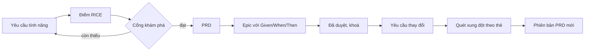

<h1 align="center">Product Management Skill Jev</h1>

<p align="center">
  <b>Trợ lý quản lý sản phẩm viết hộ tài liệu, giữ quy trình cho nghiêm, và để mọi quyết định lại cho bạn.</b><br>
  21 kỹ năng từ yêu cầu tính năng tới yêu cầu thay đổi · PRD đã duyệt thì khoá, thay đổi thành phiên bản mới · xung đột giữa các PRD tìm bằng phép quét thẻ tất định · markdown thuần trong thư mục của bạn · Telegram, cổng web hoặc Claude Code · Anthropic, OpenAI, Gemini, Groq hoặc mô hình Ollama chạy trên máy · 170 test
</p>

<p align="center">
  <a href="../README.md">English</a> · <b>Tiếng Việt</b> · <a href="README.zh-CN.md">中文</a> · <a href="README.ja.md">日本語</a> · <a href="README.fr.md">Français</a> · <a href="README.es.md">Español</a>
  <br>
  <a href="#bắt-đầu-nhanh">Bắt đầu nhanh</a> ·
  <a href="#ví-dụ">Ví dụ</a> ·
  <a href="#kỹ-năng">Kỹ năng</a> ·
  <a href="../AGENT.md">Luật của agent</a> ·
  <a href="../examples/aipm-skills-project">Dự án mẫu</a>
</p>

<p align="center">
  
  
  
  
  <a href="../LICENSE"></a>
</p>

> Bản tiếng Anh ([README.md](../README.md)) là bản gốc. Bản này có cùng dữ kiện và cùng bố cục.

## Bắt đầu nhanh

Cần Docker và một khoá API của mô hình. Claude cho tài liệu tốt nhất; khoá Groq miễn phí đủ để dùng thử.

```bash
git clone https://github.com/Nhat-Nguyet/product-skill-jev.git my-pm-workspace
cd my-pm-workspace
cp .env.example .env      # đặt AI_PROVIDER và một khoá, thêm TELEGRAM_BOT_TOKEN nếu dùng bot
bash setup.sh             # 1) bot Telegram  2) cổng web  3) cả hai
```

Bạn nhận được:

- **Cổng web** ở `http://localhost` (lựa chọn 2 và 3): bên trái là khung chat, bên phải là tài liệu đang được viết, cùng các trang Dự án, Cài đặt và Nhật ký thay đổi. Một dự án mẫu được chép vào `my-projects/` để có sẵn thứ mở ra xem ngay.
- **Bot Telegram** (lựa chọn 1 và 3): gửi `/start` cho bot, rồi `Show all projects`.
- **Claude Code** không cần Docker: `cp AGENT.md CLAUDE.md`, rồi chạy `claude` trong thư mục. Các kỹ năng ở `.claude/skills/` tự nạp.

Cả ba làm việc trên cùng các tệp, nên bạn có thể ghi một ý tưởng trên điện thoại rồi viết xong PRD ở bàn làm việc.

## Ví dụ

Bạn viết câu bình thường. Trợ lý chỉ hỏi những dữ kiện còn thiếu, đưa bản nháp, và không ghi gì cho tới khi bạn đồng ý.

```
Bạn   Tạo yêu cầu tính năng: bot Telegram để PM ghi ý tưởng khi đang di chuyển
Jev   Hai câu hỏi. Ai yêu cầu, và nó giải quyết vấn đề gì?
Bạn   Nhóm PM. Ý tưởng nằm chết trong ghi âm, không bao giờ thành tài liệu.
Jev   Bản nháp FR-001 ở dưới. Nói "lưu" để ghi.
Bạn   lưu
Jev   Đã lưu vào discovery/inbox/FR-001-telegram-bot.md
      Tiếp theo: "Chấm RICE cho FR-001"
```

Từ đó đường đi là chấm điểm, nghiên cứu, cổng khám phá, PRD, epic. Dưới đây là một đoạn của epic ở cuối đường ấy trong [dự án mẫu](../examples/aipm-skills-project), [`EP-001-v1.0.md`](../examples/aipm-skills-project/epics/EP-001-telegram-bot/EP-001-v1.0.md):

```markdown
---
doc-id: EP-001
prd: PRD-001
version: v1.0
status: approved
module: Bot
sprint: S01
---

### US-001 - Send Feature Request

**As a** Product Manager,
**I want to** describe a feature in plain language to the bot,
**So that** a structured FR document is created automatically.

**Scenario 2 - Edge case: No active project set**
Given: PM has not opened a project in this session
When:  PM sends "Create a feature request"
Then:  Bot asks "Which project is this for?" before proceeding
```

Mỗi tài liệu mang phần đầu (front matter) nối nó với phần còn lại: FR tới điểm RICE tới PRD tới epic, CR tới phiên bản PRD mà nó sinh ra.

## Cách hoạt động



Ba luật giữ cả hệ thống:

1. **Nó soạn, bạn quyết.** Mọi kỹ năng kết thúc bằng việc đưa bản nháp và chờ bạn đồng ý.
2. **Đã duyệt là khoá.** PRD đã ký duyệt không bao giờ bị sửa. Một yêu cầu thay đổi sinh ra v1.1 hoặc v2.0, lý do ghi vào changelog và `VERSIONS.md`.
3. **Cổng có giá trị thật.** Tính năng có RICE dưới 20 được hướng sang thành yêu cầu thay đổi trên một PRD có sẵn. Bản nghiên cứu thiếu mục Bảo mật và Tuân thủ thì cổng bị chặn.

Mỗi dự án là một thư mục markdown:

```
my-projects/PROJ-002-checkout-redesign/
  PROJECT.md  VERSIONS.md
  discovery/  inbox/ scoring/ research/ gate/
  prd/        PRD-004-one-tap-checkout/PRD-004-v1.0.md, PRD-004-v1.1.md, CHANGELOG.md
  epics/  cr/  stakeholders/  decisions/  sprints/  reviews/
```

Mở bằng VS Code, Obsidian hay trình soạn thảo bất kỳ. Đưa vào git thì lịch sử PRD thành một bản so sánh đọc được.

## Khác gì các lựa chọn khác

| | Dự án này | Lời nhắc viết PRD trong trợ lý chat | Công cụ viết PRD bằng AI dạng dịch vụ |
|---|---|---|---|
| Tài liệu nằm ở đâu | Markdown thuần trong thư mục của bạn | Đoạn chat bạn phải chép ra | Không gian làm việc của nhà cung cấp |
| Quy trình | FR, RICE, cổng, PRD, epic, CR; mỗi kỹ năng gợi ý bước kế | Từng tài liệu một | Chủ yếu soạn tài liệu |
| Sau khi duyệt | Khoá, thay đổi thành phiên bản mới có liên kết | Không theo dõi | Tuỳ công cụ |
| Xung đột giữa các PRD | Mã Python quét thẻ module dùng chung, rồi mô hình xếp hạng (tuỳ chọn) | Không có | Tuỳ công cụ |
| Mô hình | Bạn chọn trong năm nhà cung cấp, kể cả mô hình chạy trên máy | Mô hình của trợ lý | Mô hình của nhà cung cấp |
| Đổi cách làm việc | Sửa một `SKILL.md` bằng lời thường | Viết lại lời nhắc mỗi lần | Không làm được |

Phép quét xung đột ([`bot/tags.py`](../bot/tags.py)) là mã bình thường: nó liệt kê mọi cặp PRD dùng chung một thẻ module và báo PRD không có thẻ là "không kiểm được", khác với "không xung đột". Chỉ sau đó mô hình mới được hỏi thẻ chung ấy có phải va chạm thật không.

Các luật còn lại (soạn trước khi ghi, khoá bản đã duyệt, cổng) là chỉ dẫn trong kỹ năng, do mô hình thực hiện. Với mô hình mạnh chúng đáng tin; với mô hình yếu nên kiểm lại.

## Kỹ năng

Mỗi kỹ năng là một thư mục trong [`.claude/skills/`](../.claude/skills) chứa một `SKILL.md`. Claude Code tìm chúng qua phần mô tả; bot và backend web tìm qua bảng chỉ mục trong [`AGENT.md`](../AGENT.md).

| Nhóm | Kỹ năng |
|------|--------|
| Khám phá | create-fr, score-feature, gate-review, deep-research |
| PRD | to-prd, manage-epic, conflict-check, grill-prd, update-prd |
| Dự án | create-project, find-project, project-status |
| Yêu cầu thay đổi | intake-cr, assess-cr, approve-cr |
| Bên liên quan | add-stakeholder, draft-comms |
| Nền tảng | setup-workspace, new-sprint, version-doc, product-skill-jev |

Chúng là chỉ dẫn, không phải mã. Sửa một kỹ năng là đổi cách trợ lý làm việc.

Agent có đúng bảy công cụ: `read_file`, `write_file`, `list_files`, `search_files`, `move_file`, `scan_tags` và `judge` (xem [`bot/agent.py`](../bot/agent.py)).

## Mô hình

Đặt `AI_PROVIDER` trong `.env`, hoặc lưu nhiều khoá ở trang Cài đặt của cổng web rồi chuyển bằng một cú bấm. [`.env.example`](../.env.example) có sẵn một khối cho mỗi lựa chọn.

| Nhà cung cấp | Thiết lập |
|----------|---------|
| Anthropic Claude (tài liệu tốt nhất) | `AI_PROVIDER=anthropic` |
| OpenAI | `AI_PROVIDER=openai` |
| Groq (có gói miễn phí, hợp để dùng thử) | `AI_PROVIDER=openai` với địa chỉ của Groq |
| Google Gemini | `AI_PROVIDER=google` |
| Ollama (chạy trên máy của bạn) | `AI_PROVIDER=openai` với địa chỉ localhost |

## Tuỳ chọn: bộ phân loại Jev

Jev là bộ phân loại nhanh của TypeSafe AI, trả nhãn kèm xác suất thay vì văn xuôi. Khi đặt `TYPESAFE_API_KEY`, nó gợi ý loại và mức khẩn của phản hồi từ bên liên quan, định tuyến lệnh khi nhà cung cấp chính gặp sự cố, gợi ý thư mục cho tệp tải lên, và trả lời năm bộ câu hỏi có kiểu qua công cụ `judge`: `fr_triage`, `gate_review`, `rice_bands`, `cr_assessment`, `conflict_pair`.

Jev không bao giờ ghi tệp. Không có khoá, quá thời gian chờ hay độ tin thấp thì mọi đường đều quay về cách làm khi chưa có Jev. Câu hỏi và ngưỡng nằm ở [`bot/jev.py`](../bot/jev.py); cổng web cho phép đè ngưỡng và khôi phục mặc định. Chi tiết: [`.claude/skills/product-skill-jev`](../.claude/skills/product-skill-jev/SKILL.md).

## Lệnh và test

```bash
make start | stop | restart | logs | status | update     # bot Telegram, từ gốc kho
cd apps && make start | stop | logs | build               # cổng web
```

```bash
pip install -r tests/requirements.txt -r apps/backend/requirements.txt -r bot/requirements.txt
cd apps/backend && python3 -m pytest ../../tests/
```

Bộ test có 170 test trong năm tệp (cài đặt 35, công cụ agent 26, API backend 26, Jev 61, quét thẻ 22). Khi đã có tệp `.env` (phép kiểm cấu hình Docker đọc nó) và backend không chạy, 144 test đạt và 26 test API tự bỏ qua. Không test nào gọi API trả phí.

## Nó không phải là gì

Nó không nói chuyện với khách hàng của bạn và không bảo bạn nên làm gì. Nó viết tốt và không quên gì, đó là một kỹ năng khác với óc phán đoán. Phán đoán vẫn là của bạn.

## Ghi công và giấy phép

Dựa trên ý tưởng từ [mattpocock/skills](https://github.com/mattpocock/skills) (định dạng kỹ năng), [chấm điểm RICE](https://www.intercom.com/blog/rice-simple-prioritization-for-product-managers/) (Intercom), [Continuous Discovery Habits](https://www.producttalk.org/) (Teresa Torres), [Inspired](https://www.svpg.com/books/inspired-how-to-create-tech-products-customers-love-2nd-edition/) (Marty Cagan), [user story](https://www.mountaingoatsoftware.com/agile/user-stories) (Mike Cohn) và [Architectural Decision Records](https://adr.github.io/).

Do [Nhật Nguyệt](https://github.com/Nhat-Nguyet) duy trì. Giấy phép [CC BY-NC 4.0](../LICENSE): được dùng, chia sẻ và chỉnh sửa cho mục đích phi thương mại, kèm ghi công.
