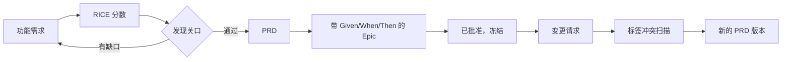

<h1 align="center">Product Management Skill Jev</h1>

<p align="center">
  <b>产品管理助手：替你写文档，让流程守规矩，所有决定留给你。</b><br>
  21 个技能，覆盖从功能需求到变更请求 · PRD 一经批准即冻结，改动生成新版本 · PRD 之间的冲突由确定性的标签扫描找出 · 纯 Markdown，存在你自己的文件夹 · Telegram、Web 门户或 Claude Code · Anthropic、OpenAI、Gemini、Groq 或本地 Ollama 模型 · 170 个测试
</p>

<p align="center">
  <a href="../README.md">English</a> · <a href="README.vi.md">Tiếng Việt</a> · <b>中文</b> · <a href="README.ja.md">日本語</a> · <a href="README.fr.md">Français</a> · <a href="README.es.md">Español</a>
  <br>
  <a href="#快速开始">快速开始</a> ·
  <a href="#示例">示例</a> ·
  <a href="#技能">技能</a> ·
  <a href="../AGENT.md">Agent 规则</a> ·
  <a href="../examples/aipm-skills-project">示例项目</a>
</p>

<p align="center">
  
  
  
  
  <a href="../LICENSE"></a>
</p>

> 英文版 [README.md](../README.md) 是原文。本译文与之事实一致、结构相同。

## 快速开始

需要 Docker 和一个模型 API 密钥。Claude 写出的文档质量最好；免费的 Groq 密钥足够试用。

```bash
git clone https://github.com/Nhat-Nguyet/product-skill-jev.git my-pm-workspace
cd my-pm-workspace
cp .env.example .env      # 设置 AI_PROVIDER 和一个密钥；使用机器人时再加 TELEGRAM_BOT_TOKEN
bash setup.sh             # 1) Telegram 机器人  2) Web 门户  3) 两者都装
```

你会得到：

- **Web 门户**，地址 `http://localhost`（选项 2 和 3）：左边是对话，右边是正在写的文档，另有项目、设置和记录每次改动的审计日志。安装时会把一个示例项目复制到 `my-projects/`，第一天就有东西可看。
- **Telegram 机器人**（选项 1 和 3）：给你的机器人发送 `/start`，再发 `Show all projects`。
- **Claude Code**，无需 Docker：`cp AGENT.md CLAUDE.md`，然后在该文件夹里运行 `claude`。`.claude/skills/` 中的技能会自动加载。

三种方式操作的是同一批文件，所以你可以在手机上记下想法，回到桌前写完 PRD。

## 示例

你用普通句子说话。助手只问缺少的事实，给出草稿，在你确认之前不写任何文件。

```
你    为 Telegram 机器人创建一个功能需求，让 PM 在路上也能记下想法
Jev   两个问题。谁提的需求？它解决什么问题？
你    PM 团队。想法停留在语音备忘录里，从来变不成文档。
Jev   下面是 FR-001 的草稿。说"保存"即写入。
你    保存
Jev   已保存到 discovery/inbox/FR-001-telegram-bot.md
      下一步："给 FR-001 打 RICE 分"
```

之后的路径是：打分、调研、发现关口、PRD、Epic。下面是[示例项目](../examples/aipm-skills-project)中这条路径终点的 Epic 节选，[`EP-001-v1.0.md`](../examples/aipm-skills-project/epics/EP-001-telegram-bot/EP-001-v1.0.md)：

```markdown
---
doc-id: EP-001
prd: PRD-001
version: v1.0
status: approved
module: Bot
sprint: S01
---

### US-001 - Send Feature Request

**As a** Product Manager,
**I want to** describe a feature in plain language to the bot,
**So that** a structured FR document is created automatically.

**Scenario 2 - Edge case: No active project set**
Given: PM has not opened a project in this session
When:  PM sends "Create a feature request"
Then:  Bot asks "Which project is this for?" before proceeding
```

每份文档都带有 front matter，把它与其他文档相连：FR 连到 RICE 分数、PRD、Epic，CR 连到它产生的 PRD 版本。

## 工作方式



三条规则支撑整个系统：

1. **它起草，你决定。** 每个技能最后都会展示草稿并等你同意。
2. **批准即冻结。** 已签署的 PRD 不再修改。变更请求会产生 v1.1 或 v2.0，原因记入 changelog 和 `VERSIONS.md`。
3. **关口是真的。** RICE 低于 20 的功能会被引导为对现有 PRD 的变更请求。调研缺少安全与合规部分时，关口被阻止。

每个项目是一个 Markdown 文件夹：

```
my-projects/PROJ-002-checkout-redesign/
  PROJECT.md  VERSIONS.md
  discovery/  inbox/ scoring/ research/ gate/
  prd/        PRD-004-one-tap-checkout/PRD-004-v1.0.md, PRD-004-v1.1.md, CHANGELOG.md
  epics/  cr/  stakeholders/  decisions/  sprints/  reviews/
```

可以用 VS Code、Obsidian 或任何编辑器打开。提交到 git 后，PRD 历史就是一份可读的 diff。

## 有何不同

| | 本项目 | 聊天助手里的 PRD 提示词 | 托管式 AI PRD 工具 |
|---|---|---|---|
| 文档存放 | 你文件夹里的纯 Markdown | 需要手动复制出来的聊天记录 | 厂商的工作空间 |
| 流程 | FR、RICE、关口、PRD、Epic、CR，每个技能提示下一步 | 一次一份文档 | 主要是起草文档 |
| 批准之后 | 冻结，改动成为有链接的新版本 | 不跟踪 | 视工具而定 |
| PRD 之间的冲突 | Python 扫描共享的模块标签，再可选地由模型排序 | 不涉及 | 视工具而定 |
| 模型 | 五家服务商任选，包括本地模型 | 助手自带的模型 | 厂商的模型 |
| 改变行为 | 用普通语言编辑一个 `SKILL.md` | 每次重写提示词 | 做不到 |

冲突扫描（[`bot/tags.py`](../bot/tags.py)）是普通代码：列出共享模块标签的每一对 PRD，并把没有标签的 PRD 报告为"无法检查"，这不等于"没有冲突"。之后才会问模型，共享的标签是否构成真正的冲突。

其余规则（先起草再写入、冻结已批准文档、关口）是技能中的指令，由模型执行。强模型下可靠，弱模型下值得复查。

## 技能

每个技能是 [`.claude/skills/`](../.claude/skills) 下的一个文件夹，内含一个 `SKILL.md`。Claude Code 通过描述找到它们；机器人和 Web 后端通过 [`AGENT.md`](../AGENT.md) 中的索引找到它们。

| 领域 | 技能 |
|------|--------|
| 发现 | create-fr, score-feature, gate-review, deep-research |
| PRD | to-prd, manage-epic, conflict-check, grill-prd, update-prd |
| 项目 | create-project, find-project, project-status |
| 变更请求 | intake-cr, assess-cr, approve-cr |
| 干系人 | add-stakeholder, draft-comms |
| 平台 | setup-workspace, new-sprint, version-doc, product-skill-jev |

它们是指令，不是代码。编辑一个技能，就改变了助手的行为。

Agent 只有七个工具：`read_file`、`write_file`、`list_files`、`search_files`、`move_file`、`scan_tags` 和 `judge`（见 [`bot/agent.py`](../bot/agent.py)）。

## 模型

在 `.env` 中设置 `AI_PROVIDER`，或在门户的设置页保存多个密钥，一键切换。[`.env.example`](../.env.example) 为每个选项准备了现成的配置块。

| 服务商 | 设置 |
|----------|---------|
| Anthropic Claude（文档质量最好） | `AI_PROVIDER=anthropic` |
| OpenAI | `AI_PROVIDER=openai` |
| Groq（有免费额度，适合试用） | `AI_PROVIDER=openai`，加 Groq 的 base URL |
| Google Gemini | `AI_PROVIDER=google` |
| Ollama（在你自己的机器上运行） | `AI_PROVIDER=openai`，加 localhost 的 base URL |

## 可选：Jev 分类器

Jev 是 TypeSafe AI 的快速分类器，返回带概率的标签而不是文字。设置 `TYPESAFE_API_KEY` 后，它会建议干系人反馈的类型和紧急程度，在主服务商故障时路由命令，为上传的文件建议存放文件夹，并通过 `judge` 工具回答五组有类型的问题：`fr_triage`、`gate_review`、`rice_bands`、`cr_assessment`、`conflict_pair`。

Jev 从不写文件。没有密钥、超时或置信度低时，所有路径都回到没有 Jev 时的行为。问题和阈值在 [`bot/jev.py`](../bot/jev.py)；门户可以覆盖阈值并恢复默认值。详见 [`.claude/skills/product-skill-jev`](../.claude/skills/product-skill-jev/SKILL.md)。

## 命令与测试

```bash
make start | stop | restart | logs | status | update     # Telegram 机器人，在仓库根目录运行
cd apps && make start | stop | logs | build               # Web 门户
```

```bash
pip install -r tests/requirements.txt -r apps/backend/requirements.txt -r bot/requirements.txt
cd apps/backend && python3 -m pytest ../../tests/
```

测试套件共 170 个测试，分布在五个文件中（安装 35、agent 工具 26、后端 API 26、Jev 61、标签扫描 22）。在有 `.env` 文件（Docker 配置检查会读取它）且后端未运行时，144 个通过，26 个 API 测试自动跳过。没有测试调用付费 API。

## 它不是什么

它不会替你和客户交谈，也不会告诉你该做什么。它写得好、什么都不忘，但这和判断力是两回事。判断力仍然属于你。

## 致谢与许可

思路来自 [mattpocock/skills](https://github.com/mattpocock/skills)（技能格式）、[RICE 评分](https://www.intercom.com/blog/rice-simple-prioritization-for-product-managers/)（Intercom）、[Continuous Discovery Habits](https://www.producttalk.org/)（Teresa Torres）、[Inspired](https://www.svpg.com/books/inspired-how-to-create-tech-products-customers-love-2nd-edition/)（Marty Cagan）、[用户故事](https://www.mountaingoatsoftware.com/agile/user-stories)（Mike Cohn）和 [Architectural Decision Records](https://adr.github.io/)。

由 [Nhat Nguyet](https://github.com/Nhat-Nguyet) 维护。采用 [CC BY-NC 4.0](../LICENSE) 许可：可在注明出处的前提下用于非商业目的的使用、分享和改编。
